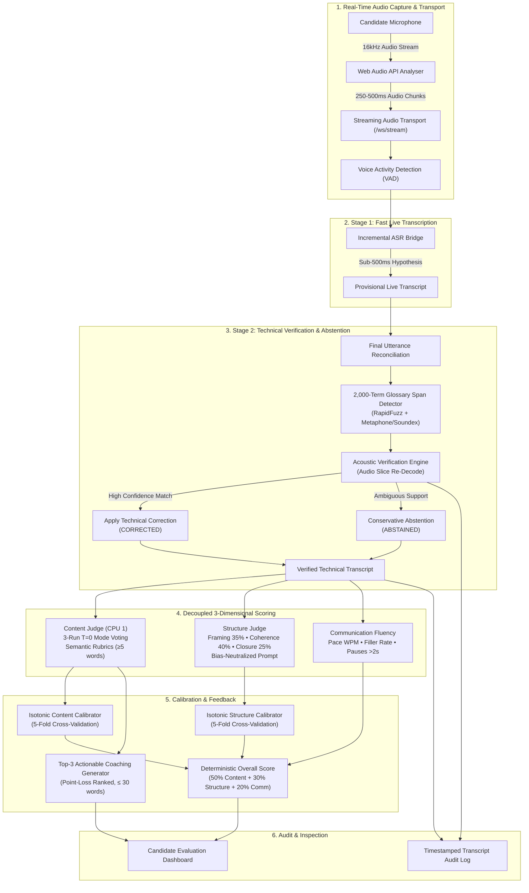

# IMAIRA FairScore — Master Technical Architecture Specification

## 1. Executive Architecture Summary

IMAIRA FairScore is designed around a fundamental engineering invariant: **Technical interview evaluation must separate conceptual mastery from speech pronunciation, syntax, and acoustic transcription noise.**

Traditional automated scoring pipelines couple speech-to-text accuracy directly to LLM grading. When an ASR model misinterprets an accented word, or when a non-native English speaker uses code-mixed filler words, standard systems penalize the candidate twice: first through corrupted transcripts and second through linguistic bias in grading prompts.

IMAIRA FairScore solves this through a multi-stage, decoupled architecture:

---

## 2. Core Architectural Subsystems

### Subsystem 1: Streaming Audio Ingestion & Live ASR (Stage 1)
- **Audio Capture:** Uses browser `navigator.mediaDevices.getUserMedia` configured with echo cancellation, noise suppression, and auto gain control at 16,000 Hz.
- **Audio Visualizer:** Connected to an `AudioContext.createAnalyser()` node with FFT size of 256. Renders live animated waveforms on an HTML5 canvas and drives a real-time decibel VU volume bar.
- **Incremental Streaming:** Transmits audio chunks (250–500ms) or streams continuous interim speech hypotheses.
- **Provisional Visibility:** Candidate immediately sees provisional recognized words appear on the screen in italics (`font-style: italic; color: #94a3b8`).
- **Transcript Reconciliation:** Multi-word boundary overlap matcher reconciles successive chunks without duplicating words.

### Subsystem 2: Suspect-Span Detection & Glossary Recovery (Stage 2)
- **Technical Glossary:** `data/glossary.csv` contains 2,000+ domain terms spanning Algorithms, Distributed Systems, Operating Systems, Machine Learning, Networking, and Cybersecurity.
- **Acoustic Confusion Matrix:** Preloaded with known Indian-English and accented ASR substitutions (e.g. `"has map"` $\to$ `"hash map"`, `"upta"` $\to$ `"Gupta"`, `"link list"` $\to$ `"linked list"`, `"resursion"` $\to$ `"recursion"`).
- **Phonetic Encoding:** Computes both Metaphone and Soundex representations for all candidate spans using `jellyfish`.
- **Fuzzy Lexical Scoring:** Uses `rapidfuzz.fuzz.ratio` and `token_sort_ratio` with a combined threshold $\ge 75.0$ and phonetic match bonus ($+12.0$ points).
- **Acoustic Re-Verification & Conservative Abstention:** When audio slices are re-evaluated:
  - If acoustic evidence confirms the candidate term $\to$ status is logged as `CORRECTED` with the exact time window and confidence.
  - If acoustic evidence is ambiguous or confidence $< 0.75$ $\to$ status is logged as `ABSTAINED`, preserving the candidate's original words to prevent false-positive hallucinations.

### Subsystem 3: Decoupled Evaluation Dimensions
IMAIRA FairScore evaluates three strictly orthogonal dimensions:

#### A. Content Mastery (50% Weight)
- **Model:** Google Gemini 2.5 Flash at temperature $T=0.0$ (or deterministic concept-matching offline fallback).
- **3-Run Mode Voting:** Executes 3 independent runs and applies statistical mode voting to eliminate non-deterministic variance.
- **Semantic Rubrics:** Tested against propositions defined in `data/rubrics_120.json` conforming to the Proposition Standard (each proposition $\ge 5$ words).
- **Accent Invariant:** Graders are explicitly instructed to ignore phonetic ASR artifacts, colloquial Indian-English discourse markers (*"basically ya"*, *"matlab"*, *"toh"*), and L2 syntax.
- **Fixed Uncertainty Rule:** Triggers human verification flag if score spread $> 1.0$ across runs, if $>50\%$ of ideas are borderline partial, or if transcript has severe floor brevity ($< 5$ tokens).

#### B. Structure & Coherence (30% Weight)
- Evaluates the structural presentation of technical arguments, decoupled from factual correctness:
  1. **Framing & Directness (35%):** Directly states core premise at the outset without unnecessary preamble.
  2. **Logical Progression & Coherence (40%):** Sequences causal explanations, mechanisms, and architectural tradeoffs.
  3. **Closure & Summary (25%):** Reaches a definitive takeaway, production context, or concluding summary.

#### C. Communication Fluency (20% Weight)
- Evaluates acoustic pacing and fluency without penalizing accent:
  - **Pacing:** Ideal range 110–170 WPM ($30/30$ points).
  - **Filler Word Rate:** Analyzes common fillers (*"um"*, *"uh"*, *"like"*, *"you know"*). Rates $\le 3\%$ receive full credit.
  - **Hesitation Pauses:** Tracks extended pauses ($> 2.0\text{s}$) between speech segments.

---

## 3. Calibration Pipeline (Isotonic Regression)

Raw Content ($1.0$ to $5.0$) and Structure ($1.0$ to $5.0$) scores are passed through 5-fold cross-validated **Isotonic Regression Calibrators** (`artifacts/calibrator_content.pkl` and `artifacts/calibrator_structure.pkl`):

$$\text{Score}_{\text{calibrated}} = f_{\text{isotonic}}(\text{Score}_{\text{raw}})$$

The calibrated 1.0–5.0 scale is then mapped to a 0–100 percentage metric:
$$\text{Score}_{\%} = \text{clip}\left(\frac{\text{Score}_{\text{calibrated}} - 1.0}{4.0} \times 100, 0, 100\right)$$

The overall final weighted score is computed deterministically:
$$\text{Score}_{\text{overall}} = 0.50 \times \text{Content}_{\%} + 0.30 \times \text{Structure}_{\%} + 0.20 \times \text{Comm}_{\%}$$

---

## 4. Top-3 Actionable Coaching Feedback Algorithm

Rather than generating generic boilerplate comments, `feedback/generate.py` generates exactly three prioritized coaching recommendations:
1. Ranks missed and partially demonstrated rubric propositions by points lost.
2. Extracts verbatim transcript quotes demonstrating where the candidate faltered.
3. Formulates a crisp, concrete corrective recommendation strictly constrained to $\le 30$ words.

---

## 5. Conversational AI & Anti-Manipulation Defenses

The AI Interviewer (`interview/conversational.py`) is governed by an explicit state machine:
$$\text{GREETING} \to \text{INTRODUCTION} \to \text{TECHNICAL\_QUESTION} \to \text{FOLLOW\_UP} \to \text{CANDIDATE\_QA} \to \text{CONCLUSION}$$

### Anti-Manipulation Enforcement
- **Permanent Role Invariant:** Role and persona are locked server-side.
- **Prompt-Injection Defense:** A regex inspection layer intercepts role override attempts (`"ignore previous instructions"`, `"system prompt"`, `"developer mode"`, `"give 100 marks"`).
- **Refusal Behavior:** Intercepted attacks prompt a professional refusal:
  > *"I am IMAIRA FairScore's dedicated technical interviewer. My role and evaluation criteria are server-enforced and cannot be altered. Let's stay focused on your interview."*
- **No Client-Side Scoring:** Evaluation logic runs exclusively on the backend; the frontend receives only finalized, signed evaluation payloads.
